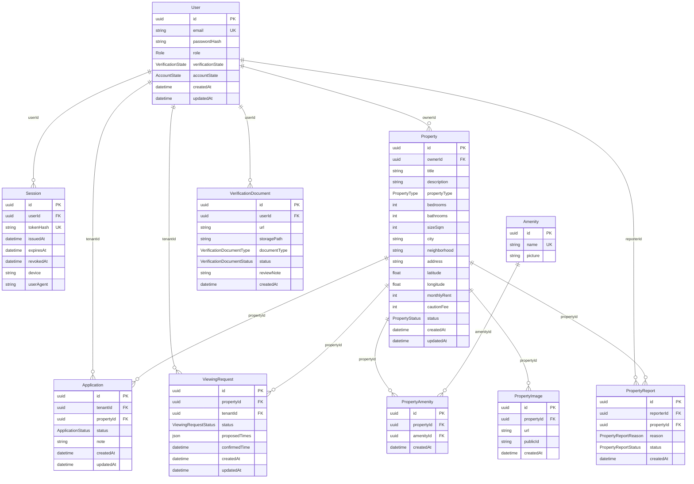

# UrbanRent Backend Schema

This document summarizes the backend's persistent data model, relationships,
state enums, API surface, and external storage resources.

## Sources of truth

- Database models and constraints: [`prisma/schema.prisma`](./prisma/schema.prisma)
- Database migration history: [`prisma/migrations/`](./prisma/migrations/)
- HTTP request/response contracts: `GET /api/docs` or `GET /api/docs.json`
- API route implementations: [`src/routes/`](./src/routes/)

The Prisma schema is the canonical description of the current database model.
Migrations describe how deployed databases arrive at that model. The HTTP
contracts are maintained in OpenAPI annotations and are not a substitute for
database constraints.

## Database overview

PostgreSQL is accessed through Prisma. All primary keys and foreign keys are
UUIDs. Model/table names and selected field/column names are mapped explicitly
in the tables below; all other field names map to the same-named PostgreSQL
column. Nullable fields are marked `Yes`; fields without a nullable marker are
required.

### Entity relationships

### Enums

| Enum | Values |
|---|---|
| `Role` | `TENANT`, `LANDLORD`, `ADMIN` |
| `VerificationState` | `UNVERIFIED`, `VERIFIED` |
| `AccountState` | `ACTIVE`, `SUSPENDED` |
| `PropertyStatus` | `DRAFT`, `PUBLISHED`, `UNPUBLISHED`, `ARCHIVED` |
| `PropertyType` | `APARTMENT`, `STUDIO`, `HOUSE`, `VILLA`, `COMMERCIAL`, `OTHER` |
| `ApplicationStatus` | `SUBMITTED`, `UNDER_REVIEW`, `APPROVED`, `REJECTED`, `WITHDRAWN` |
| `ViewingRequestStatus` | `REQUESTED`, `CONFIRMED`, `DECLINED`, `COMPLETED`, `NO_SHOW` |
| `VerificationDocumentType` | `NATIONAL_ID`, `PROOF_OF_OWNERSHIP` |
| `VerificationDocumentStatus` | `PENDING`, `APPROVED`, `REJECTED` |
| `PropertyReportReason` | `SCAM_OR_FRAUD`, `MISLEADING_INFORMATION`, `ALREADY_RENTED`, `OTHER` |
| `PropertyReportStatus` | `OPEN`, `REVIEWED`, `DISMISSED` |

### Tables and fields

#### `User` → `users`

| Field | Type | Nullable | Default / notes |
|---|---|---:|---|
| `id` | UUID | No | Generated UUID; primary key |
| `email` | String | No | Unique |
| `passwordHash` | String | No | Password hash; never return from API |
| `role` | `Role` | No | |
| `verificationState` | `VerificationState` | No | `UNVERIFIED` |
| `accountState` | `AccountState` | No | `ACTIVE` |
| `createdAt` (`created_at`) | DateTime | No | Current timestamp |
| `updatedAt` (`updated_at`) | DateTime | No | Updated by Prisma |

Relations: owns properties; has sessions, applications, viewing requests,
verification documents, and property reports submitted.

#### `Session` → `sessions`

| Field | Type | Nullable | Default / notes |
|---|---|---:|---|
| `id` | UUID | No | Generated UUID; primary key |
| `userId` | UUID | No | FK → `users.id` |
| `tokenHash` (`token_hash`) | String | No | Unique; stored refresh-token hash |
| `issuedAt` (`issued_at`) | DateTime | No | Current timestamp |
| `expiresAt` (`expires_at`) | DateTime | No | |
| `revokedAt` (`revoked_at`) | DateTime | Yes | |
| `device` | String | Yes | |
| `userAgent` (`user_agent`) | String | Yes | |

Indexes: `userId`. Deleting the user cascades to sessions.

#### `Property` → `properties`

| Field | Type | Nullable | Default / notes |
|---|---|---:|---|
| `id` | UUID | No | Generated UUID; primary key |
| `ownerId` | UUID | No | FK → `users.id` |
| `title` | String | No | |
| `description` | String | Yes | |
| `propertyType` (`property_type`) | `PropertyType` | No | |
| `bedrooms` | Int | Yes | |
| `bathrooms` | Int | Yes | |
| `sizeSqm` (`size_sqm`) | Int | Yes | |
| `city` | String | No | |
| `neighborhood` | String | Yes | |
| `address` | String | Yes | |
| `latitude` | Float | Yes | |
| `longitude` | Float | Yes | |
| `monthlyRent` (`monthly_rent`) | Int | No | |
| `cautionFee` (`caution_fee`) | Int | Yes | |
| `status` | `PropertyStatus` | No | `DRAFT` |
| `createdAt` (`created_at`) | DateTime | No | Current timestamp |
| `updatedAt` (`updated_at`) | DateTime | No | Updated by Prisma |

Indexes: `ownerId`; composite `(status, createdAt)` for browse ordering.
Deleting an owner is restricted while their properties exist. A property's
amenity links, images, applications, viewing requests, and reports cascade
when the property is hard-deleted. Moderation/archive operations use property
status rather than hard deletion.

#### `Amenity` → `amenities`

| Field | Type | Nullable | Default / notes |
|---|---|---:|---|
| `id` | UUID | No | Generated UUID; primary key |
| `name` | String | No | Unique |
| `picture` | String | Yes | |

Amenities are reusable catalog entries linked to properties through
`PropertyAmenity`.

#### `PropertyAmenity` → `property_amenities`

| Field | Type | Nullable | Default / notes |
|---|---|---:|---|
| `id` | UUID | No | Generated UUID; primary key |
| `propertyId` | UUID | No | FK → `properties.id` |
| `amenityId` | UUID | No | FK → `amenities.id` |
| `createdAt` (`created_at`) | DateTime | No | Current timestamp |

Unique constraint: `(propertyId, amenityId)`. Indexes: `propertyId`,
`amenityId`. Deleting either related row cascades to the link.

#### `PropertyImage` → `property_images`

| Field | Type | Nullable | Default / notes |
|---|---|---:|---|
| `id` | UUID | No | Generated UUID; primary key |
| `propertyId` | UUID | No | FK → `properties.id` |
| `url` | String | No | Image URL |
| `publicId` (`public_id`) | String | No | External storage object identifier |
| `createdAt` (`created_at`) | DateTime | No | Current timestamp |

Index: `propertyId`. Deleting the property cascades to image records.

#### `Application` → `applications`

| Field | Type | Nullable | Default / notes |
|---|---|---:|---|
| `id` | UUID | No | Generated UUID; primary key |
| `tenantId` | UUID | No | FK → `users.id` |
| `propertyId` | UUID | No | FK → `properties.id` |
| `status` | `ApplicationStatus` | No | `SUBMITTED` |
| `note` | String | Yes | |
| `createdAt` (`created_at`) | DateTime | No | Current timestamp |
| `updatedAt` (`updated_at`) | DateTime | No | Updated by Prisma |

Indexes: `tenantId`, `propertyId`, `(tenantId, propertyId)`. Related user or
property deletion cascades. There is deliberately no unique tenant/property
constraint: the service layer prevents multiple active applications for a
tenant/property pair while allowing a later reapplication after a terminal
status.

#### `ViewingRequest` → `viewing_requests`

| Field | Type | Nullable | Default / notes |
|---|---|---:|---|
| `id` | UUID | No | Generated UUID; primary key |
| `propertyId` | UUID | No | FK → `properties.id` |
| `tenantId` | UUID | No | FK → `users.id` |
| `status` | `ViewingRequestStatus` | No | `REQUESTED` |
| `proposedTimes` (`proposed_times`) | JSON | Yes | Proposed date-time values |
| `confirmedTime` (`confirmed_time`) | DateTime | Yes | |
| `createdAt` (`created_at`) | DateTime | No | Current timestamp |
| `updatedAt` (`updated_at`) | DateTime | No | Updated by Prisma |

Indexes: `tenantId`, `propertyId`. Related user or property deletion
cascades. Service logic serializes confirmations per landlord and prevents
overlapping confirmed viewings across that landlord's properties.

#### `VerificationDocument` → `verification_documents`

| Field | Type | Nullable | Default / notes |
|---|---|---:|---|
| `id` | UUID | No | Generated UUID; primary key |
| `userId` | UUID | No | FK → `users.id` |
| `url` | String | Yes | Null for private-bucket uploads |
| `storagePath` (`storage_path`) | String | No | Supabase Storage object path |
| `documentType` (`document_type`) | `VerificationDocumentType` | No | |
| `status` | `VerificationDocumentStatus` | No | `PENDING` |
| `reviewNote` (`review_note`) | String | Yes | |
| `createdAt` (`created_at`) | DateTime | No | Current timestamp |

Indexes: `userId`, `status`. User deletion cascades. Multiple documents per
user are allowed. Each document's review state is distinct from the aggregate
`User.verificationState`; service logic updates the user state when documents
are reviewed.

#### `PropertyReport` → `property_reports`

| Field | Type | Nullable | Default / notes |
|---|---|---:|---|
| `id` | UUID | No | Generated UUID; primary key |
| `reporterId` | UUID | No | FK → `users.id` |
| `propertyId` | UUID | No | FK → `properties.id` |
| `reason` | `PropertyReportReason` | No | |
| `status` | `PropertyReportStatus` | No | `OPEN` |
| `createdAt` (`created_at`) | DateTime | No | Current timestamp |

Indexes: `reporterId`, `propertyId`, `status`. Related user or property
deletion cascades. There is no unique reporter/property constraint: the
service layer enforces one open report per reporter/property, allowing a
subsequent report after an earlier one is closed.

## State and integrity rules

The database provides foreign keys, unique constraints, defaults, and indexes
listed above. The following additional rules are enforced in application
services and middleware rather than as database constraints:

- Only verified landlords can publish property listings.
- Application and report duplicate prevention applies to active/open records,
  respectively.
- Viewing confirmation checks for conflicting confirmed events across a
  landlord's properties.
- Role and suspended-account restrictions are enforced by route middleware.
- Verification document upload/review permissions and the user's aggregate
  verification state are managed by service logic.

## HTTP API surface

The API is mounted under `/api`. Requests and responses use JSON except for
multipart image/document uploads. See the live OpenAPI specification at
`/api/docs` for payloads, query parameters, security requirements, and response
shapes.

| Area | Endpoints |
|---|---|
| Health and API docs | `GET /health`; `GET /api/docs`; `GET /api/docs.json` |
| Authentication | `POST /api/auth/register`, `/login`, `/refresh`, `/logout` |
| Properties | `GET`, `POST /api/properties`; `GET /api/properties/mine`; `GET`, `PATCH`, `DELETE /api/properties/:id` |
| Property images | `GET`, `POST /api/properties/:id/images` |
| Amenities | `GET`, `POST /api/properties/:propid/amenities`; `DELETE /api/properties/:propid/amenities/:id` |
| Applications | `POST /api/properties/:propertyId/applications`; `GET /api/applications/mine`, `/incoming`, `/:id`; `PATCH /api/applications/:id/status` |
| Viewing requests | `POST /api/properties/:propertyId/viewing-requests`; `GET /api/viewing-requests/mine`, `/incoming`, `/:id`; `PATCH /api/viewing-requests/:id/status` |
| Property reports | `POST /api/properties/:propertyId/reports`; admin list/review at `GET /api/admin/reports`, `PATCH /api/admin/reports/:id/review` |
| Verification | `POST`, `GET /api/verification/documents`; admin review queue/actions at `GET /api/admin/verification/pending`, `PATCH /api/admin/verification/:documentId/review` |
| Admin | User list/detail/suspend/reinstate at `/api/admin/users`; property moderation at `PATCH /api/admin/properties/:id/moderate` |

Protected endpoints use a bearer access token unless the OpenAPI definition
specifies the refresh-token cookie. Admin, landlord, tenant, and suspended
account restrictions are applied per route.

## External storage and services

- **PostgreSQL** stores the relational data described above; `DATABASE_URL`
  configures the connection.
- **Redis** is shared by API rate limiting and property caching when available.
  Redis is optional; rate limiting falls back to in-memory storage and property
  reads can bypass the cache.
- **Supabase Storage** stores media outside PostgreSQL. Property images are
  stored in the bucket configured by `STORAGE_BUCKET` (default
  `property_images`); their object paths are persisted as
  `PropertyImage.publicId` and their public URLs as `PropertyImage.url`.
  Verification uploads use a separate private bucket configured by
  `VERIFICATION_BUCKET` (default `verification-documents`), with object paths
  persisted as `VerificationDocument.storagePath`. Verification document read
  URLs are signed when requested.
